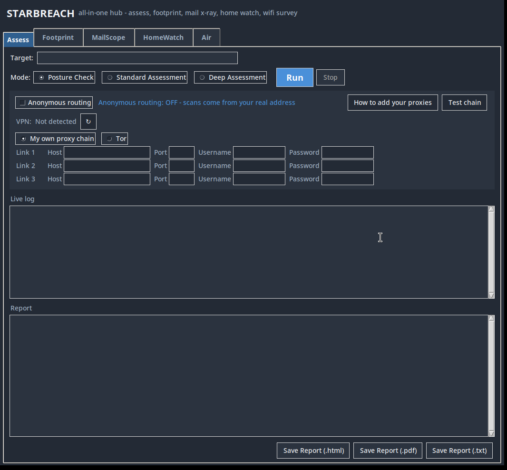

# STARBREACH

**A family of security tools that explain themselves in plain English.**

Most security tools are built by experts, for experts: you run them from a terminal, and they hand you a wall of raw output you're expected to already understand. STARBREACH is the same kind of testing, rebuilt for the rest of us — one target, pick how deep to go, press Run, and read a verdict written like a person talking.

## The family

STARBREACH is a family of security tools — a web assessment platform, a Windows desktop application (STARBREACH Desktop), and a Linux recon edition. Same design philosophy across all three: serious security testing, explained in plain English.

> Inspired by AutoRecon and reconFTW — rebuilt from scratch for beginners.

## STARBREACH Desktop — the all-in-one hub (Windows)

The flagship right now is the Desktop hub: five tools in one window, no terminal, no accounts, nothing to configure before the first run.

### Assess
Point it at a website you own and pick a depth:

- **Posture Check** — the outside view anyone can see: email anti-spoofing records (SPF, DMARC, DKIM), encryption, and certificate health, rolled into a letter grade.
- **Standard Assessment** — open ports with service banners, exposed files (verified by content, never guessed from a status code — a catch-all error page produces zero findings), WordPress checks, and security headers.
- **Deep Assessment** — a wider port sweep, JavaScript mining for leaked keys (shown redacted), GraphQL and JWT probes, a reflected-XSS confirmation test, and full vulnerability-scanner runs when those tools are installed.

Every mode can check the software versions it finds against the national vulnerability database. A known bug only becomes a finding when the official data confirms your exact version is affected — "probably vulnerable" goes in a separate *Could Not Verify* section, not the findings list.

Two extras live in this tab:

- **Anonymous routing** — route scans through a 1–3 link proxy chain you build yourself, or through Tor. It **fails closed**: if any link is dead, nothing is scanned and nothing quietly falls back to your real address. An amber warning box appears the moment routing is on, stating plainly that proxied results are *less accurate* — a timeout can make an open port look closed — and that a system-wide VPN is the best option for hidden-address scanning. The app also detects whether a VPN is actually running and says so.
- **Reports** in text, HTML, and PDF that stamp how the scan was routed and how much the results can be trusted, alongside every finding's evidence and fix.

### Footprint
See yourself the way an attacker doing homework sees you. Enter your own email and it checks known data breaches (which ones, what year, what data types leaked) and whether a public profile is attached to it. Enter a username and it checks 30+ sites for accounts under that name. Every answer is one of three honest states: **found**, **not found**, or **could not verify** — sites that block checking get labeled, never guessed about.

### MailScope
An X-ray for suspicious email. Paste a message's headers or open an `.eml` file and it checks the sender's paperwork (SPF / DKIM / DMARC), flags when the reply address or return path doesn't match who the mail claims to be from, traces where the message actually entered the internet, dissects every link (including display text that lies about where the link goes, lookalike brand domains, and punycode tricks), and flags dangerous attachments. The verdict — **Likely Safe**, **Suspicious**, or **Likely Phishing** — always shows its reasons, and an email with no authentication on record can never earn a clean "safe."

### HomeWatch
A guard dog for your home network. It sweeps the network, lists every device it finds with its maker, and remembers them by hardware address. Name a device once and the name sticks. Anything that shows up later that the app has never seen gets flagged **NEW DEVICE**. It re-checks every five minutes — with the honest limit printed right in the tab: it only watches while the app is open.

### Air
A survey of every WiFi network around you, built from Windows' own scan data: signal, channel, and security for each network, with flags for open networks, ancient broken encryption, and a possible **evil twin** (the same network name showing up with mismatched security — labeled a *suspect* to verify, never an accusation). The tab also says upfront what it cannot do: Windows drivers don't allow monitor mode or handshake capture, so that part of WiFi work belongs to the Linux edition with a USB adapter. No fake capabilities.

## The web platform

The original STARBREACH runs as a web platform. Its free **Posture Check** grades a domain's public security posture from public records only. **Deep Assessments** go further — staged scanning, proof moves, and retests — and run **only** with the site owner's written authorization and a locked scope. Platform-hosted sites are limited to the public posture layer.

## The Linux recon edition

The Linux edition chains its checks together the way the big tools do: one finding triggers the next scan (a domain leads to subdomains, subdomains to live hosts, hosts to ports, ports to services, services to the checks that fit them), with a plain-English log teaching as it goes. Every run ends in a **Hackability Score** per device and per website — A means wide open, F means locked down — and the score is *remembered*, so you can watch a device's grade improve over time and see exactly what changed. Development is currently focused on the Windows hub; the Linux edition is the next chapter, not an abandoned one.

## The rules every STARBREACH tool is built on

- **Evidence only.** A finding exists because something was checked and confirmed — never because a tool "usually means" something.
- **"Could not verify" is a valid answer.** When a check can't be proven either way, the tools say so instead of guessing.
- **Fail closed.** If an anonymous route breaks, the scan stops. Nothing ever falls back to a direct connection silently.
- **Reports grade themselves.** Routed scans carry a reliability warning in the report, because a slow proxy chain and a locked-down server can look identical from the far end.
- **Passwords are never saved.** Proxy passwords are typed per session and live in memory only. Reports never contain proxy addresses or credentials.
- **Your data stays yours.** Scan history and device lists live in local files on your own machine.

## Authorization

These tools are built for testing systems you own or are authorized to test — your own websites, your own network, your own devices. That's not fine print; it's the whole point of the project: learn how attackers look at your stuff, by looking at it first, yourself.

**Source code is private.** This repository is the showcase — the story, the design, and the screenshots. The engines stay closed.
